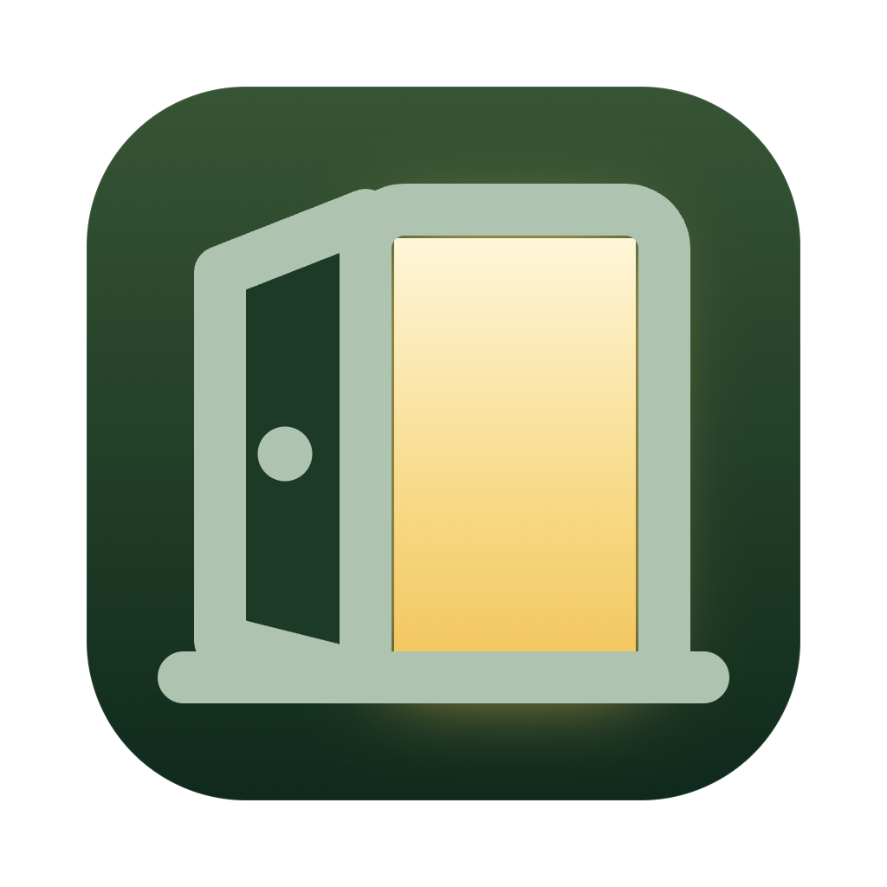

<h1 align="center">DoorPass</h1>

DoorPass encrypts your computer's DNS lookups and gets around simple website blocking, on macOS and Windows. It is a desktop port of [Intra](https://github.com/Jigsaw-Code/Intra), Jigsaw's Android app, and runs the same networking code.

**[Download DoorPass](https://github.com/DoorPassApp/DoorPass/releases)**

- macOS 13 or later, Apple silicon and Intel: `DoorPass-<version>-mac.dmg` (about 13 MB)
- Windows 10/11 on Intel or AMD: `DoorPass-<version>-win-x64-setup.exe` (about 7 MB)

## What it does

DoorPass runs a small tunnel on your own computer; nothing is routed through a remote server. Every DNS lookup is sent encrypted over DNS-over-HTTPS (DoH) to the server you pick, Google Public DNS by default, so your network can't read or change it. In **Full** mode, the Intra behaviour, it also splits the TLS hello of HTTPS connections across two packets, which defeats filters that block sites by the name in that hello. **DNS only** mode encrypts lookups and leaves all other traffic alone.

It does not hide which servers you connect to or change your IP address; it is not a VPN to another network.

## Using it

Click the door in the menu bar (macOS) or the system tray (Windows) to open DoorPass, then click the round door button to turn protection on or off. The gear opens a menu with the mode, the DNS server, Preferences, About and Quit. The main window has the full server list, a custom server option, the session counters and an optional query log, which is off by default.

On first launch, DoorPass asks for an administrator password once to install its background helper, the part that sets up the tunnel. The builds are unsigned for now: on macOS, right-click the app and choose Open the first time; on Windows, choose More info, then Run anyway, when SmartScreen warns.

## Repository layout

- `desktop/` is DoorPass: the app (Go and [Wails](https://wails.io), drawn with the system web view), the privileged helper, packaging and the build script. Building, testing and the design are documented in [`desktop/README.md`](desktop/README.md).
- `Android/` is the upstream Intra Android app. DoorPass uses its Go networking core in `Android/app/src/go/` unchanged, which is why it is kept here; the Android app itself is not part of DoorPass.

## Credits and license

DoorPass is built on Intra by Jigsaw Operations LLC and keeps its history. Both are released under the [Apache License 2.0](LICENSE). The Windows helper ships the [Wintun](https://www.wintun.net/) driver, under its own license (included in the installer).
